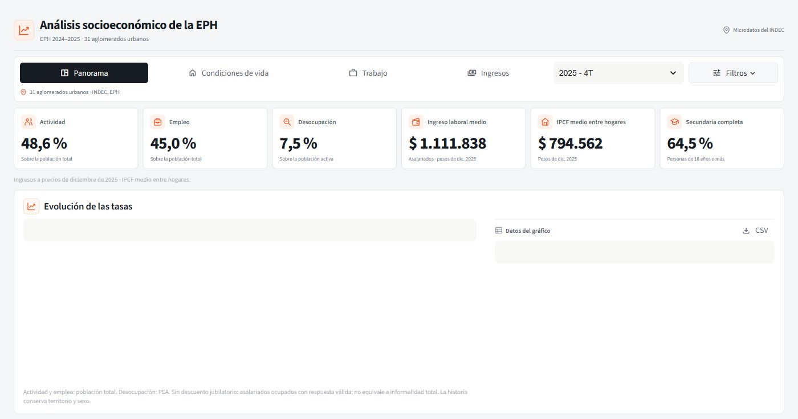

# EPH · Análisis socioeconómico

Tablero interactivo en Python sobre vivienda, educación, mercado de trabajo e ingresos, construido con microdatos de la Encuesta Permanente de Hogares del INDEC.

**EPH 2024–2025 · 31 aglomerados urbanos**



## Qué muestra el tablero

- En 4T 2025, el **36,3 % de los asalariados** no tenía descuento jubilatorio. [INDEC, mercado de trabajo, cuadro 1.5](https://www.indec.gob.ar/uploads/informesdeprensa/mercado_trabajo_eph_4trim25AF451E16DE.pdf)
- En ese trimestre, el **64,5 % de las personas de 18 años o más** había completado al menos la secundaria. El indicador se calcula con los microdatos de la EPH.
- El ingreso medio de la ocupación principal de asalariados con ingresos fue **$1.082.635 nominales**. En el tablero se expresa como **$1.111.838 a precios de diciembre de 2025**. [INDEC, distribución del ingreso, cuadro 6.1](https://biblioteca.indec.gob.ar/bases/minde/ingresos4trim25.pdf#page=11)

El proyecto descarga las bases oficiales, vincula hogares y personas y calcula estimaciones con los ponderadores de cada indicador. Las mismas figuras se pueden explorar en Streamlit y en VS Code. La app permite filtrar por territorio y sexo, cambiar el trimestre y descargar los resultados en CSV.

Las tasas laborales y el ingreso asalariado nominal se cotejaron con los informes del INDEC. Los indicadores con aperturas propias, como el ingreso por educación y sexo, se recalcularon por separado a partir de los microdatos.

## Ejecutar

Requiere Python 3.12. En PowerShell, desde la carpeta del proyecto:

```powershell
python -m venv .venv
.venv\Scripts\python -m pip install -r requirements.txt
foreach ($year in 2024,2025) {
    foreach ($quarter in 1,2,3,4) {
        .venv\Scripts\python sync_sources.py eph --year $year --quarter $quarter
    }
}
.venv\Scripts\python -m streamlit run app.py
```

Abrir `http://127.0.0.1:8501`. En Linux/macOS, usar `.venv/bin/python` en lugar de `.venv\Scripts\python` y descargar cada trimestre con el mismo comando `sync_sources.py eph`.

Para ver los gráficos dentro de **VS Code**, abrir `graficos_vscode.py`, seleccionar el intérprete `.venv` y ejecutar las celdas de preparación, filtros y análisis. La web y VS Code comparten gráficos y cálculos.

## Datos y método

Los microdatos se descargan directamente de [INDEC](https://www.indec.gob.ar/indec/web/Institucional-Indec-BasesDeDatos-1); no se incluyen en GitHub y no requieren una clave de API. `data/reference.json` contiene las referencias territoriales, la clasificación de actividades y los factores de precios de esta instantánea.

- Población, vivienda y educación: **PONDERA**. Educación: 18 años o más; analfabetismo: 10 años o más.
- Ingreso laboral: asalariados ocupados con P21 positivo, **PONDIIO**.
- Ingreso individual por educación y sexo: PEA con P47T positivo, **PONDII**.
- IPCF: promedio entre hogares y deciles nacionales de hogares, **PONDIH**. El filtro de sexo no se aplica a hogares.
- Las comparaciones por sexo incluyen el total de ambos sexos del mismo período y territorio.

**Ajuste por inflación:** ingreso nominal × IPC diciembre de 2025 / IPC medio del trimestre. Es una aproximación trimestral; los ingresos relevados se refieren al mes anterior a la entrevista. Los deciles conservan los cortes nacionales. Los indicadores de vivienda son trimestrales; el informe de condiciones de vida del INDEC es semestral.

Fuentes: [mercado de trabajo 4T2025](https://www.indec.gob.ar/uploads/informesdeprensa/mercado_trabajo_eph_4trim25AF451E16DE.pdf), [distribución del ingreso 4T2025](https://biblioteca.indec.gob.ar/bases/minde/ingresos4trim25.pdf), [condiciones de vida 2S2025](https://www.indec.gob.ar/uploads/informesdeprensa/eph_indicadores_hogares_04_266C2447C938.pdf) e [IPC nacional](https://www.indec.gob.ar/ftp/cuadros/economia/sh_ipc_01_26.xls).

## Archivos

`app.py` muestra el tablero; `metrics.py` calcula indicadores; `charts.py` define los gráficos; `formatting.py` prepara las tablas; `ui.py` y `editorial.css` definen el diseño. `sync_sources.py` descarga las bases y `graficos_vscode.py` permite explorarlas en el editor. La configuración de Streamlit, las referencias, las dependencias y este README completan el proyecto.

El repositorio incluye el código, las referencias y una captura del panorama. Las estimaciones se verificaron en los ocho trimestres de la cobertura. La revisión de filtros abarcó selecciones representativas.

**José Ignacio González Cabañas** · Elaboración propia con datos del INDEC.
