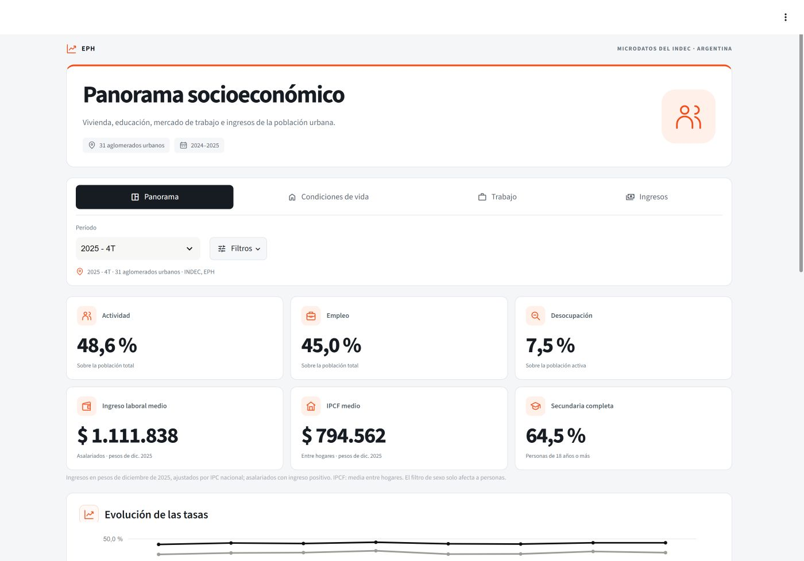

# EPH · Panorama socioeconómico

Tablero interactivo para explorar **vivienda, educación, mercado de trabajo e ingresos** con microdatos de la Encuesta Permanente de Hogares del INDEC.

**Cobertura:** 31 aglomerados urbanos · 2024-2025 · Ingresos a precios de diciembre de 2025.



[Ver el PDF de presentación](output/pdf/EPH_LinkedIn.pdf) · [Consultar la auditoría](AUDITORIA.md)

## Qué permite explorar

- **Panorama:** indicadores principales y evolución trimestral.
- **Condiciones de vida:** vivienda, servicios, tenencia y educación.
- **Trabajo:** participación, empleo, desocupación, composición laboral y ramas de actividad.
- **Ingresos:** distribución entre hogares, diferencias por educación y sexo, y evolución del ingreso laboral por rama.

Los filtros de período, región, aglomerado y sexo permiten explorar los resultados. Las comparaciones por sexo incluyen un **Total de ambos sexos del mismo período y territorio**. Las tablas permanecen visibles y se pueden descargar en CSV. El diseño se adapta a escritorio y móvil.

## Herramientas

Python · pandas · Plotly · Streamlit. Los gráficos también se pueden ejecutar en la ventana interactiva de VS Code mediante las celdas de `graficos_vscode.py`.

La interfaz web y las celdas comparten un único catálogo de gráficos en `charts.py` y las mismas definiciones de cálculo en `metrics.py`.

## Ejecutar el proyecto

Requiere **Python 3.12** y conexión a internet para descargar inicialmente las bases oficiales. No se necesita una clave de API.

Desde la carpeta del proyecto, en PowerShell:

```powershell
python -m venv .venv
.venv\Scripts\python -m pip install -r requirements-lock.txt

foreach ($year in 2024,2025) {
    foreach ($quarter in 1,2,3,4) {
        .venv\Scripts\python sync_sources.py eph --year $year --quarter $quarter
    }
}

.venv\Scripts\python -m streamlit run app.py
```

Abrir `http://127.0.0.1:8501`. En Windows también se puede usar `abrir_tablero.cmd` después de preparar el entorno y descargar los datos.

En Linux/macOS:

```bash
python3.12 -m venv .venv
.venv/bin/python -m pip install -r requirements-lock.txt
for year in 2024 2025; do
  for quarter in 1 2 3 4; do
    .venv/bin/python sync_sources.py eph --year "$year" --quarter "$quarter"
  done
done
.venv/bin/python -m streamlit run app.py
```

Para VS Code, abrir `graficos_vscode.py`, seleccionar el intérprete `.venv` y ejecutar primero las celdas de preparación y filtros. Las figuras se muestran dentro del editor.

## Fuentes y definiciones

| Indicador | Universo y ponderación |
|---|---|
| Actividad y empleo | Población total; PONDERA |
| Desocupación | Población económicamente activa; PONDERA |
| Sin descuento jubilatorio | Asalariados ocupados con respuesta válida; PONDERA |
| Vivienda y servicios | Personas u hogares según la base seleccionada; PONDERA |
| Educación | Personas de 18 años o más; PONDERA |
| Analfabetismo | Personas de 10 años o más; PONDERA |
| Ingreso laboral | Asalariados ocupados con P21 positivo; PONDIIO |
| Ingreso individual por educación y sexo | PEA con P47T positivo; PONDII |
| IPCF | Media entre hogares y deciles nacionales de hogares; PONDIH |

**Pesos constantes:** ingreso nominal multiplicado por IPC de diciembre de 2025 / IPC promedio del trimestre. Es una aproximación trimestral: el ingreso relevado se refiere al mes anterior a la entrevista. La base aparece junto a los gráficos de ingresos y en las descargas.

El IPCF medio entre hogares difiere del promedio ponderado por personas de los informes oficiales. El filtro de sexo no se aplica a hogares. Las aperturas territoriales conservan los cortes de los deciles nacionales. Los indicadores de vivienda del tablero son trimestrales; el informe de condiciones de vida del INDEC es semestral.

Fuentes oficiales:

- [Bases de microdatos EPH](https://www.indec.gob.ar/indec/web/Institucional-Indec-BasesDeDatos-1).
- [Mercado de trabajo, cuarto trimestre de 2025](https://www.indec.gob.ar/uploads/informesdeprensa/mercado_trabajo_eph_4trim25AF451E16DE.pdf).
- [Distribución del ingreso, cuarto trimestre de 2025](https://biblioteca.indec.gob.ar/bases/minde/ingresos4trim25.pdf).
- [Condiciones de vida, segundo semestre de 2025](https://www.indec.gob.ar/uploads/informesdeprensa/eph_indicadores_hogares_04_266C2447C938.pdf).
- [Serie histórica del IPC nacional](https://www.indec.gob.ar/ftp/cuadros/economia/sh_ipc_01_26.xls).

Este proyecto es una elaboración propia con fuentes oficiales; no es una publicación del INDEC. La instantánea analizada abarca 2024-2025.

## Validación

```text
python validar.py
python auditar_tablas.py
python auditar_seguridad.py
python smoke_test.py
```

La revisión numérica incluye **243 conciliaciones** y **6.038 comprobaciones** sobre tablas e integridad, con recálculo desde los TXT. Se verificaron universos, ponderadores, uniones, ajuste por inflación y seis combinaciones adicionales de filtros de sexo y territorio. No se probaron todas las combinaciones posibles ni se calcularon intervalos de confianza para cada estimación. [Alcance y resultados](AUDITORIA.md).

## Estructura

```text
app.py                   Interfaz Streamlit
metrics.py               Lectura de bases y cálculos ponderados
charts.py                Catálogo compartido de gráficos y tablas
formatting.py            Formatos, unidades y tablas comparativas
ui.py / editorial.css    Iconos locales y diseño adaptable
graficos_vscode.py       Exploración por celdas en VS Code
sync_sources.py          Descarga de fuentes oficiales
actualizar_ipc.py        Actualización y validación del IPC
data/                    Referencias, trazabilidad y controles
docs/                    Captura del tablero
output/pdf/              Presentación para LinkedIn
```

Los microdatos individuales, el entorno virtual, los secretos y los archivos temporales se excluyen de Git. El repositorio conserva referencias y resultados agregados. La app se ejecuta localmente; el repositorio no implica que exista una demo pública desplegada.

**Autor:** José Ignacio González Cabañas.
